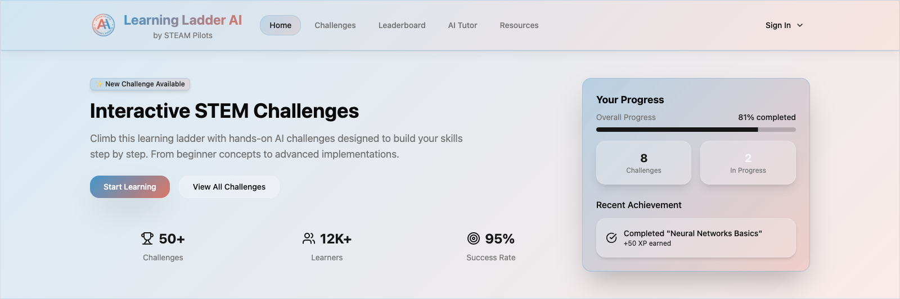
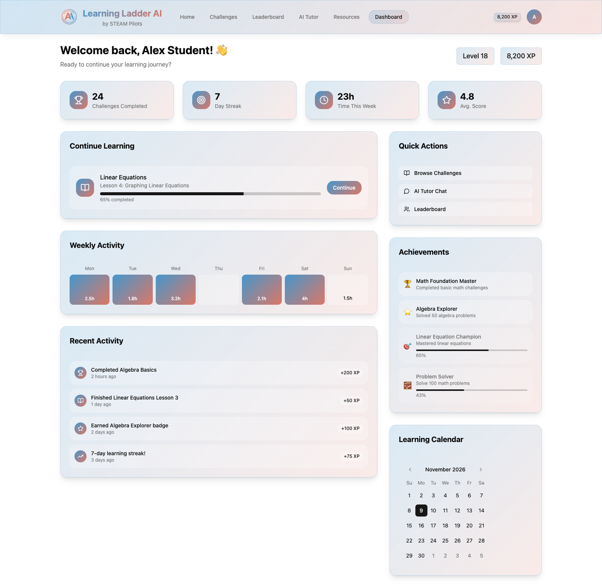
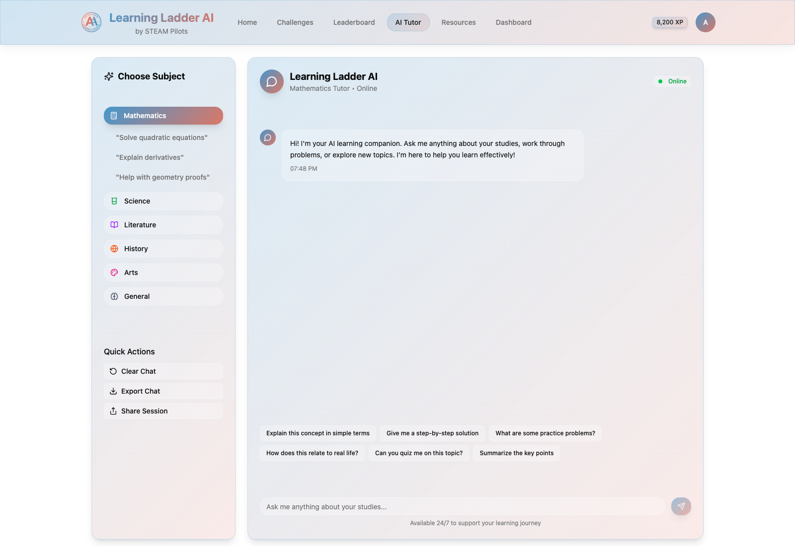

<h1 align="center">Learning Ladder AI</h1>

<p align="center">Adaptive STEM tutoring with generated questions, answer grading, and conversational learning sessions.</p>

<p align="center">
  <a href="https://react.dev/"></a>
  <a href="https://www.typescriptlang.org/"></a>
  <a href="https://vite.dev/"></a>
  <a href="https://ui.shadcn.com/"></a>
</p>

<p align="center">
  <a href="https://www.python.org/"></a>
  <a href="https://fastapi.tiangolo.com/"></a>
  <a href="https://ai.google.dev/"></a>
</p>

Learning Ladder AI is a STEM tutoring prototype with adaptive question generation, answer grading, and conversational tutoring powered by Gemini. React and TypeScript interfaces connect to a Python FastAPI backend; a CLI exposes the learning ladder directly.

Developed during work with STEAM Pilots. This repository preserves the project and its contributors' work under the existing [MIT license](LICENSE).

## Screenshots

Captured from a local run of the [homepage concept](frontend/homepage-concept/). Profiles, metrics, progress, and activity are built-in sample data. The tutor view is an interface prototype; the Gemini-connected tutor in `frontend/chatbot-interface/` requires the backend and an API key.

### Homepage



### Student dashboard



### Tutor interface concept



## Structure

- `frontend/chatbot-interface/`: conversational tutor interface.
- `frontend/homepage-concept/`: homepage and dashboard concept.
- `backend/`: Gemini integration, adaptive learning sessions, FastAPI routes, and CLI.
- `docs/`: interface guidelines and project notes.

## Quick start

Use Python 3.10+, Node.js, and pnpm 9.12.0. Run the following from the repository root:

```bash
python3 -m venv .venv
source .venv/bin/activate
python -m pip install -r backend/requirements.txt
cp backend/.env.example backend/.env
```

Add your own Google AI Studio key to `GEMINI_API_KEY` in `backend/.env`, then start the API:

```bash
python -m uvicorn backend.app.api:app --reload --host 127.0.0.1 --port 8000
```

In a second terminal, start the chatbot interface:

```bash
pnpm install
cp frontend/chatbot-interface/.env.example frontend/chatbot-interface/.env
pnpm run dev:chatbot
```

Open `http://localhost:3000`. The frontend template points to the local backend at `http://localhost:8000`. Use `pnpm run dev:homepage` separately to explore the homepage concept.

See [backend setup](backend/README.md) and [frontend setup](frontend/README.md) for more detail.

## Configuration and release boundaries

Keep `GEMINI_API_KEY` on the backend. Never put a provider key in frontend code or a `VITE_*` variable, which is exposed to the browser. Real `.env` files are ignored by Git; the checked-in templates contain no credentials. Model access and API usage depend on your own Google account and configuration.

This is a local prototype. The API has no authentication or rate limiting, permits cross-origin requests, and stores sessions in memory. Add deployment controls before exposing it to the internet or using it with real learner information. No hosted service is provided by this repository.

## Known limitations

- The interfaces are prototypes, with remaining text overlap and responsive layout issues.
- Generated questions, answers, and grading can be incorrect and require review.
- Sessions are not persisted across backend restarts.

## License and attribution

Project code uses the [MIT license](LICENSE). Retain its copyright and permission notice when redistributing.

The frontend prototypes include shadcn/ui components and Unsplash imagery with their own attribution and license terms. See the [chatbot attributions](frontend/chatbot-interface/src/Attributions.md) and [homepage attributions](frontend/homepage-concept/src/Attributions.md).
